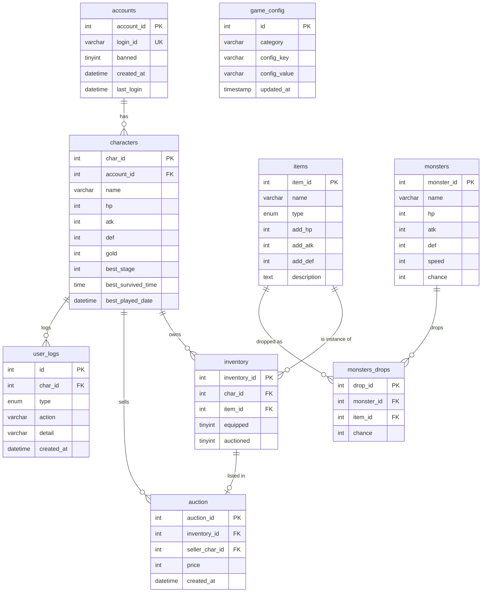

[README.md](https://github.com/user-attachments/files/35137607/README.md)
# 🧟 Zombie Survival

브라우저에서 플레이하는 2D 좀비 서바이벌 게임과, 게임 데이터를 MariaDB로 관리하는 Node.js 백엔드입니다.
아이템 거래, 강화, 장착, 게임 결과 저장 같은 핵심 로직을 **저장 프로시저 · 트리거 · 뷰**로 DB 레벨에서 처리하도록 설계했습니다.


## 📌 주요 기능

### 게임 (Phaser 3)
- WASD / 방향키로 이동하며 몰려오는 몬스터를 처치
- 몬스터 처치 시 코인 · 다이아 · 장비 아이템 드롭
- 경험치가 차면 레벨업 → 스킬 선택 팝업
- 스테이지가 오를수록 몬스터 수 증가 (`game_config` 테이블에서 값 조절)
- 게임 종료 시 도달 스테이지, 생존 시간, 획득 골드, 보상 아이템을 서버에 저장

### 서비스
- **카카오 로그인** + JWT 인증
- **인벤토리**: 장비 장착 (모자 / 상의 / 하의 / 신발 / 장갑 / 무기), 골드로 스탯 강화
- **경매장**: 아이템 판매 등록 / 구매 / 등록 취소
- **랭킹**: 최고 스테이지 기준
- **관리자 API**: 대시보드 통계, 유저 관리(아이템 · 골드 지급, 정지), 밸런스 조정, 로그 조회, DB 백업 / 복구


## 🛠 기술 스택

| 구분 | 기술 |
|---|---|
| Frontend | Phaser 3.90, JavaScript (ES Modules), HTML / CSS |
| Backend | Node.js, Express 5 |
| Database | MariaDB (`mysql2/promise`) |
| Auth | Kakao OAuth 2.0, JWT (`jsonwebtoken`) |


## 🗄 DB 설계

### ERD



### 저장 프로시저 (6개)

게임 재화와 아이템이 오가는 작업은 모두 프로시저로 처리합니다.
6개 모두 `START TRANSACTION` + `SELECT ... FOR UPDATE`로 동시 요청을 막고, 검증에 실패하면 `SIGNAL`로 에러를 던진 뒤 `ROLLBACK`합니다.

| 프로시저 | 하는 일 | 주요 검증 |
|---|---|---|
| `sp_buy_item` | 경매 아이템 구매, 골드 이동, 소유권 이전 | 경매 존재 여부, 골드 부족 |
| `sp_sell_item` | 인벤토리 아이템을 경매장에 등록 | 가격 유효성, 장착 중인 아이템, 중복 등록 |
| `sp_cancel_sell_item` | 경매 등록 취소 | 판매자 본인 여부 |
| `sp_enhance_stat` | 골드를 써서 HP / ATK / DEF 강화 (비용 = 현재 스탯 × 10) | 골드 부족, 잘못된 스탯 |
| `sp_equip_item` | 장비 장착 / 해제 | 소유권, 경매 중인 아이템 |
| `sp_save_game` | 게임 결과 저장, 최고 기록 갱신, 보상 지급 | 스테이지 · 생존 시간 · 골드 · 처치 수 유효성 (스테이지 대비 처치 수가 비정상이면 거부) |

### 트리거 (5개)

유저 행동 로그를 애플리케이션 코드가 아니라 DB가 자동으로 `user_logs`에 남깁니다.

| 트리거 | 시점 | 기록 내용 |
|---|---|---|
| `trg_auction_sell_log` | `AFTER INSERT ON auction` | 경매 등록 |
| `trg_inventory_buy_log` | `AFTER UPDATE ON inventory` | 아이템 구매 |
| `trg_inventory_equip_log` | `AFTER UPDATE ON inventory` | 장비 장착 / 해제 |
| `trg_stat_enhance_log` | `AFTER UPDATE ON characters` | 스탯 강화 |
| `trg_save_game_end_log` | `AFTER UPDATE ON characters` | 게임 종료 기록 |

### 뷰 (3개)

| 뷰 | 용도 |
|---|---|
| `v_auction` | 경매 목록 (경매 + 인벤토리 + 아이템 + 판매자 이름 조인) |
| `v_character_equipped_stats` | 캐릭터별 장착 장비 보너스 스탯 합계 |
| `v_ranking` | 최고 스테이지 → 골드 순 랭킹 |


## 📁 프로젝트 구조

```
.
├── index.js                 # Express 서버 진입점 (포트 3000)
├── dump11-28.sql            # DB 스키마 + 초기 데이터 + 프로시저/트리거/뷰
├── .env.example             # 환경변수 견본
├── server
│   ├── config/db.js         # MariaDB 커넥션 풀
│   ├── middlewares/auth.js  # JWT 검증
│   ├── routes/              # API 라우트 (admin/ 포함)
│   └── controllers/         # 비즈니스 로직 (admin/ 포함)
└── client
    ├── index.html
    ├── assets/              # 이미지 리소스
    └── src
        ├── game.js          # Phaser 진입점
        ├── scenes/          # Load, Main, Play, Popup 씬 + 팝업 HTML
        ├── managers/        # Game, Combat, Level, Drop, Data 등
        ├── characters/      # Player, Monster
        ├── factorys/        # Bullet, Item, Monster 생성
        └── items/  effects/  ui/  utils/  config/  data/
```

## 🚀 실행 방법

### 1. 패키지 설치
```bash
npm install
```

### 2. DB 생성 및 덤프 가져오기
```bash
mysql -u root -p -e "CREATE DATABASE rpg_game DEFAULT CHARACTER SET utf8mb4;"
mysql -u root -p rpg_game < dump11-28.sql
```
> 덤프는 MariaDB 12.1.2에서 만들어졌습니다.

### 3. 환경변수 설정
```bash
cp .env.example .env
```
`.env`를 열어 카카오 REST API 키, JWT 시크릿, DB 접속 정보를 채웁니다.

### 4. 카카오 개발자 설정
[Kakao Developers](https://developers.kakao.com)에서 앱을 만들고, Redirect URI에 아래 주소를 등록합니다.
```
http://localhost:3000/api/auth/kakao/callback
```

### 5. 서버 실행
```bash
node index.js
```
브라우저에서 http://localhost:3000 으로 접속합니다.


## 📡 API

`🔒` 표시는 JWT 인증이 필요한 API입니다.

### 인증 `/api/auth`
| Method | URL | 설명 |
|---|---|---|
| GET | `/kakao/login` | 카카오 로그인 페이지로 이동 |
| GET | `/kakao/callback` | 카카오 로그인 콜백, JWT 발급 |
| GET | `/kakao/logout` | 로그아웃 |

### 플레이어 `/api/player`
| Method | URL | 설명 |
|---|---|---|
| POST | `/register` 🔒 | 캐릭터 생성 |
| PATCH | `/update/stats` 🔒 | 스탯 수정 |

### 게임 `/api/game`
| Method | URL | 설명 |
|---|---|---|
| GET | `/` 🔒 | 캐릭터 · 게임 데이터 조회 |
| GET | `/config` | 게임 설정값 조회 |
| POST | `/save` 🔒 | 게임 결과 저장 |

### 인벤토리 `/api/inventory`
| Method | URL | 설명 |
|---|---|---|
| GET | `/` 🔒 | 인벤토리 조회 |
| PATCH | `/enforce` 🔒 | 스탯 강화 |
| PATCH | `/equip` 🔒 | 장비 장착 / 해제 |
| POST | `/sell` 🔒 | 경매장 판매 등록 |

### 경매장 `/api/auction`
| Method | URL | 설명 |
|---|---|---|
| GET | `/` 🔒 | 경매 목록 |
| POST | `/buy` 🔒 | 구매 |
| DELETE | `/cancel` 🔒 | 등록 취소 |

### 랭킹 `/api/ranking`
| Method | URL | 설명 |
|---|---|---|
| GET | `/` 🔒 | 랭킹 조회 |

### 관리자 `/api/admin`
| 경로 | 기능 |
|---|---|
| `/dashboard` | 요약 통계, 가입 통계, 스테이지 통계, 최근 로그인 |
| `/users` | 유저 목록, 아이템 지급, 골드 지급, 정지 |
| `/balance` | 아이템 / 몬스터 / 스테이지 밸런스 조회 및 저장 |
| `/logs` | 로그인 / 유저 / 관리자 로그 |
| `/settings` | 관리자 계정 관리, DB 백업 / 복구 |


